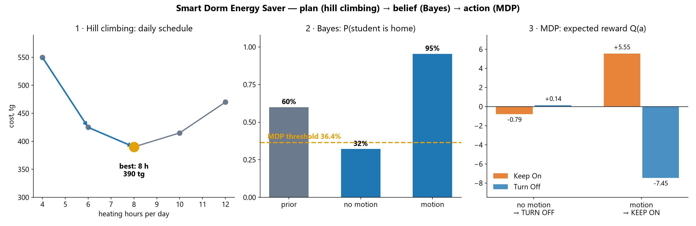

# Smart Dorm Energy Saver

**AI Fundamentals: Final Project**
Bolat Rauan, Stream 2, Practice 2 (individual project)

**Live demo:** https://rauanking.github.io/smart-dorm/
To run offline, open `index.html` in any browser. No installation is needed.



## Problem

In winter, students in Astana dormitories often heat their rooms with an electric heater (about 1.5 kW). Running it all day wastes money while the room is empty. Switching it off leaves the student cold.

**Goal:** keep the room warm while the student is home and save electricity while the room is empty.

## Three AI topics, one pipeline

```
 1 HILL CLIMBING        2 BAYES                    3 MDP                    4 ONE DAY
 best daily plan  →  P(student is home | sensor) →  Keep On / Turn Off   →  tenge saved
 (local search)      (probabilistic reasoning)     (sequential decisions)
```

| Course topic | Algorithm | Sub-problem | Default result |
|---|---|---|---|
| Search / local search | Steepest-descent hill climbing | Which of 5 heating schedules has the lowest cost (electricity + discomfort)? | 8 h/day, 390 tg (path 4 → 6 → 8) |
| Probabilistic reasoning | Bayes' rule | The sensor saw no motion for 30 min. Is the student still home? | P(Home \| no motion) = 0.321 |
| Sequential decision making | MDP, one Bellman update | Given that belief, keep the heater on or turn it off? | Turn Off (Q = +0.14 vs −0.79) |

How the parts connect:
- The hill-climbing plan says which hours the heater should run.
- During each of those hours, Bayes turns the sensor reading into a belief that the student is home.
- The MDP turns the belief into an action.
- The agent runs all 24 hours. Inside the plan it turns the heater **off** when the room is probably empty. Outside the plan it turns the heater **on** when it sees the student.
- On the simulated day the agent heats for 5 h instead of 8 h: **187.5 tg instead of 300 tg, 38% saved, about 3 375 tg per month**. If the student is home 10:00–22:00, it heats exactly those 12 hours.

Bonus: hill climbing on a full 24-hour on/off schedule (2²⁴ ≈ 16.8 million options) with 10 random restarts.

## Web application

The page `index.html` lets you run every step yourself:
1. **Plan the day.** Choose a start schedule and watch hill climbing move step by step on the cost curve.
2. **Is the student home?** Switch the sensor reading and move the prior and sensor-accuracy sliders. Every step of the Bayes calculation is shown.
3. **Keep on or turn off?** Edit the reward table. The page shows the Q-values, the decision and the threshold probability.
4. **One winter day.** All 24 hours. Presets (typical day, away all evening, home 12 h, home all day), or click any hour to flip its sensor reading. Shows the cost, savings or extra comfort heating.
5. **Bonus.** Run 10 random restarts of 24-hour hill climbing.

## Repository

| File | Purpose |
|---|---|
| `smart_dorm.py` | Reference implementation in Python (console demo: `python smart_dorm.py --bonus`) |
| `smartdorm.js` | The same algorithms as pure JavaScript functions, used by the web app |
| `index.html`, `app.js` | Web application (user interface) |
| `SmartDorm_Colab.ipynb` | Notebook version; open it in Google Colab and choose *Runtime → Run all* |
| `tests/test_smart_dorm.py` | 13 unit tests of the Python algorithms |
| `tests/consistency_test.js` | 198 checks that the web app gives exactly the same results as Python, over 6 parameter sets |
| `make_figure.py`, `smart_dorm_overview.png` | Overview figure |
| `docs/Smart_Dorm_Technical_Report_Bolat_Rauan.docx` / `.pdf` | Technical report |
| `docs/Smart_Dorm_Presentation_Bolat_Rauan.pptx` | 6-slide presentation (speaker notes included) |
| `docs/Smart_Dorm_Demo_Video_Bolat_Rauan.mp4` | 2-minute demo video (AI narration, subtitles) |
| `docs/AI_Usage_Declaration_Bolat_Rauan.docx` / `.pdf` | AI usage declaration |
| `docs/Team_Contribution_Statement_Bolat_Rauan.docx` / `.pdf` | Team contribution statement |
| `docs/build_docs.py`, `docs/video/make_video.py` | Scripts that build the documents and the video |

## Testing

```bash
python tests/test_smart_dorm.py                              # 13 unit tests
python tests/make_reference.py && node tests/consistency_test.js   # Python vs JavaScript: 198 checks
```

The unit tests check:
- hill climbing from both ends reaches 8 h, and the result equals the true minimum;
- the Bayes posteriors are 0.321 and 0.955, and the probabilities sum to 1;
- the MDP turns the heater off for "no motion" and keeps it on for "motion";
- the decision threshold is 8/22;
- the day simulation saves 112.5 tg;
- the agent heats outside the plan when the student is home (10–22 gives exactly 12 hours) and stays off without motion;
- the bonus returns a valid 24-hour schedule.

The consistency test found and fixed one real bug: in Python, the default prior was fixed when the function was defined, so changing the setting had no effect.

## Assumptions

This is a toy model, and all numbers are hypothetical:

| Parameter | Value |
|---|---|
| Heater, electricity price | 1.5 kW at 25 tg/kWh, so 37.5 tg per hour |
| Discomfort penalties | 400, 200, 90, 40, 20 tg for 4–12 h |
| Prior P(Home) | 0.6 inside the plan, 0.3 outside it |
| Sensor model | P(no motion \| Home) = 0.30, P(no motion \| Empty) = 0.95 |
| Rewards per hour | Keep On: +6 if home, −4 if empty. Turn Off: −8 if home, +4 if empty |

## Limitations and future work

- Real data from a smart meter and a sensor log would replace the assumed numbers.
- The prior could differ by hour of the day.
- More sensors (door, Wi-Fi presence) could be combined with Naive Bayes.
- Full value iteration with room-temperature dynamics would let the agent pre-heat before the student returns.
- The model could run on a real ESP32 motion sensor in a dorm room.

## AI usage

An AI assistant (Claude) helped write and structure the code, the web interface and the documents. See `docs/AI_Usage_Declaration` for details.
